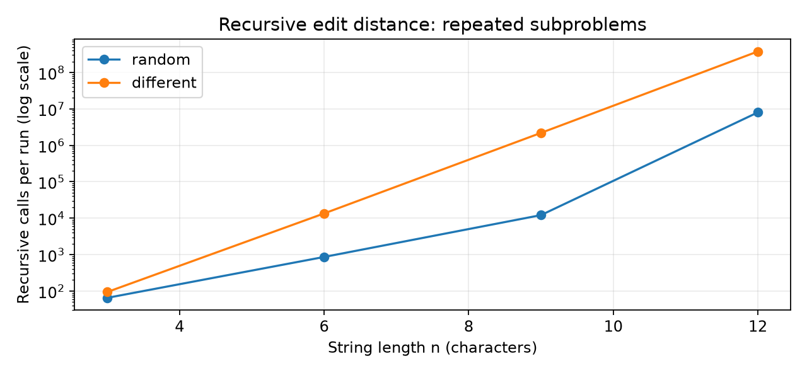
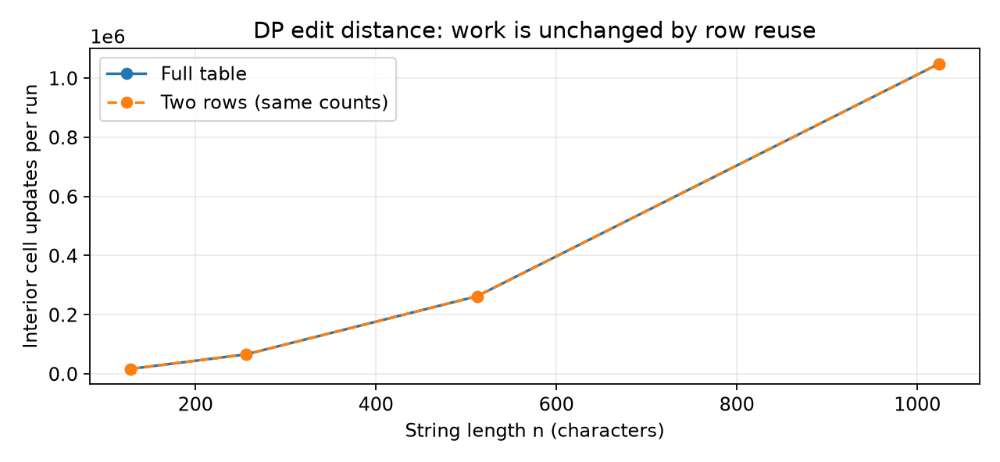
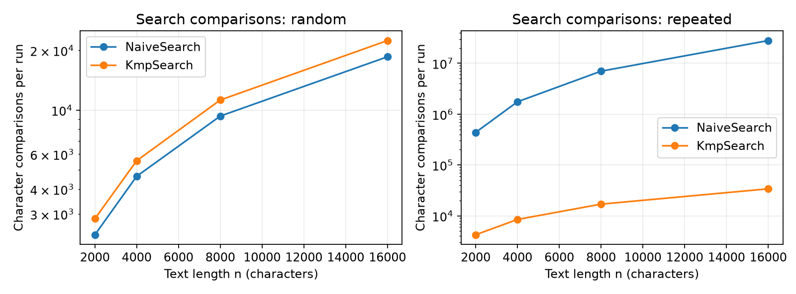
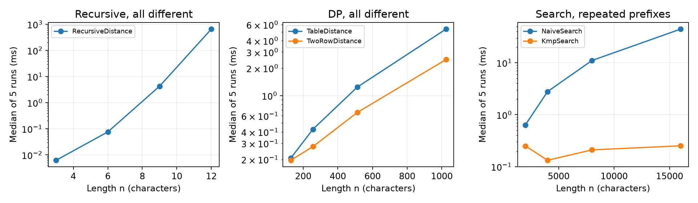

# Assignment 4: Dynamic Programming and String Algorithms

Arystanali Yessenaliyev | SE-2525

## Experiment Design Card (written before measurement)

| Field | Plan |
| --- | --- |
| Questions | Edit distance: how much repeated work does recursion do compared with DP, and does two-row storage change the number of updates? Search: when does KMP save comparisons over Naive? |
| Sizes | Recursive distance: n = 3, 6, 9, 12 to keep exponential work manageable. Table and two rows: 128, 256, 512, 1024 to expose quadratic growth. Search: text n = 2000, 4000, 8000, 16000, pattern m = n/8 to expose quadratic Naive growth. Every algorithm has four sizes and a largest/smallest ratio of at least four. |
| Inputs | Edit distance: independent random strings over ABCD, and A^n versus B^n (all branches needed in recursion). Search: independent random text/pattern over ABCD (usually early mismatches), and A^n with pattern A^(m-1)B (long failed prefixes at every start). |
| Metrics | Five timed runs after one unrecorded warm-up per case; report median milliseconds. Count recursive calls including base cases, interior DP cell updates, and character comparisons for search including KMP preprocessing. Counters are incremented inside algorithms and reset per call. |
| Reproducibility | InputGenerator uses java.util.Random with seed 2525, reset for each edit implementation and for search. Table and two-row versions receive the same inputs; both searches also share their inputs. Inputs, answers and counters repeat for the same command; elapsed times naturally vary. |
| Prediction | Recursive worst-case calls grow exponentially. DP updates grow quadratically, with identical counts for table and two rows. Naive has quadratic comparisons on repeated inputs because m grows with n; KMP stays linear. Random input should make Naive competitive. |
| Plots | Recursive calls on a log y-axis; DP cell updates; repeated-input search comparisons; median time panels for both input types. Each plot answers whether measured growth supports the prediction. |

## DP definition and implementation

State D(i,j) is the distance between prefixes a[0..i) and b[0..j). Base cases are D(0,j)=j and D(i,0)=i. If the last characters match, D(i,j)=D(i-1,j-1); otherwise D(i,j)=1+min(D(i-1,j),D(i,j-1),D(i-1,j-1)).

RecursiveDistance evaluates that recurrence directly without memory, using O(n+m) stack depth and exponential worst-case time. TableDistance fills D in increasing i,j with O(nm) time and O(nm) extra space. TwoRowDistance uses the same state, transition and base cases, but keeps only the previous and current rows: O(nm) time and O(m) extra space. These definitions are documented here because the requested source code contains no comments.

## Results

The experiment produced 200 measured rows: 5 algorithms x 2 input types x 4 sizes x 5 runs. One untimed warm-up preceded each case. Measurements used Java 17.0.20.1 on Windows; times include allocation and KMP preprocessing. Search n is text length; edit n is the length of each string. The result column contains distance or number of matches. The operations column is recursive calls or DP updates; comparisons is used only for search, and an unused counter is zero.

Takeaway: all-different recursive calls rise from 94 at n=3 to 377,393,953 at n=12, showing repeated subproblems on the logarithmic axis.

Takeaway: table and two rows have exactly the same counts; doubling n multiplies updates by four for both input types.

Takeaway: random input favors early Naive mismatches, while repeated prefixes make Naive comparisons grow much faster than KMP (both panels use logarithmic y-axes).

Takeaway: the largest repeated-prefix search separates the algorithms clearly, but small timing points are distorted by JVM warm-up and measurement noise.

| Largest case | Median time (ms) | Measured work per run |
| --- | ---: | ---: |
| Recursive, all different, n=12 | 651.1827 | 377,393,953 calls |
| Table, all different, n=1024 | 5.3458 | 1,048,576 updates |
| Two rows, all different, n=1024 | 2.4804 | 1,048,576 updates |
| Naive, repeated, n=16000, m=2000 | 44.4593 | 28,002,000 comparisons |
| KMP, repeated, n=16000, m=2000 | 0.2519 | 33,998 comparisons |

## Prediction versus result

Edit distance followed the predicted work growth. DP updates increased from 16,384 at n=128 to 1,048,576 at n=1024: an eightfold length increase produced 64 times the work. Two-row storage reduced memory, without reducing cell updates. Recursive random input at n=12 needed 8,021,130 calls, much less than the all-different case, because matching last characters skip the three-way branch. Recursive calls and DP updates are different work units and the size ranges differ, so their raw counts are not direct speed ratios.

Search also followed the prediction. On repeated inputs, increasing n eightfold raised Naive comparisons about 64 times (437,750 to 28,002,000), while KMP rose about eight times (4,248 to 33,998). At n=16000, Naive used about 824 times as many comparisons. On random input at that size, Naive used 18,573 comparisons versus KMP's 22,418, including LPS construction; KMP is not always cheaper on easy data. No change to the planned experiment was needed.

## Short answers

**Which input made string search slowest?** Repeated text A^n and pattern A^(m-1)B made Naive slowest. Almost the entire pattern matches before the final character fails at every candidate start. Naive repeats these comparisons, whereas KMP uses LPS to reuse the matched prefix. With m=n/8, Naive's O(nm) behavior becomes quadratic in n; this is not a fixed-pattern-length experiment.

**How large an n could recursive edit distance handle?** The largest tested size was n=12, with a worst-case median of about 651 ms and 377 million calls. This is the chosen experiment limit, not a measured maximum that the computer can handle. I stopped the size range there because the branching recurrence repeats subproblems exponentially; several larger sizes would greatly increase the total time for five runs. Stack depth is O(n+m), so repeated work, rather than stack capacity at n=12, is the practical limit here.

**What changes with two rows?** Both DP versions still perform n*m interior updates. At n=m=1024, the full table stores 1,050,625 integers, while two rows store only 2,050 integers: about 4.01 MiB versus 8.01 KiB of integer payload, excluding Java object overhead. The two-row version was faster on the largest all-different input, but this timing advantage is specific to this run. It loses the stored history used for straightforward edit-operation reconstruction, although the final distance remains available.

**Which search would I choose for the city platform?** I would choose KMP for long logs because its O(n+m) work is predictable even with repeated prefixes. It returns every match, including overlaps, and does not move backwards through the text. Naive is simpler and can be competitive for short, easy inputs, but the repeated-prefix experiment shows its worst-case risk. Spell-check is a separate job: two-row edit distance can compare a typed street name with each candidate name.

## A paragraph on time

Five-run medians are useful but do not make timing perfectly stable. For example, random Naive search fell from 0.2014 ms at n=2000 to 0.0704 ms at n=16000, despite its comparison count increasing; the JVM compiled and optimized code as the experiment progressed. One warm-up per case did not eliminate all compilation effects, allocation costs, garbage collection or operating-system scheduling. The smallest cases therefore support no precise speed ranking, while the larger hard cases show clearer separation. Counters provide the more reproducible growth evidence; a fixed seed reproduces inputs, answers and counts, not identical elapsed times.

## Validation

JUnit 5 tests passed all reference distances, LPS arrays, overlapping matches and edge cases. They also cross-checked 100 random short edit pairs and 100 random search cases using fixed seeds, and checked counter reset behavior. README.md contains the build commands and AI-use acknowledgement.
